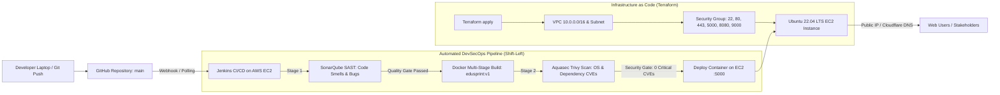

# EduSprint — DevSecOps Lab CIAP Microproject
### Shah & Anchor Kutchhi Engineering College (SAKEC)
**Course:** DevSecOps Lab (Course Code: CSCOR1PC302)
**Student Developer:** Sujal Shah
**Department:** Cyber Security / Information Technology
**Affiliated To:** University of Mumbai
**UN Sustainable Development Goal:** **SDG 9: Industry, Innovation, and Infrastructure**
**Reference Syllabus & Lab Guide:** [SAKEC DevSecOps Lab Repository](https://github.com/yatin73/sakec-devsecops-lab.git)

---

## 1. Project Overview & SDG 9 Alignment
**EduSprint** is a secure, cloud-native Agile Project Planning and Risk Monitoring platform engineered for academic and enterprise software development teams. Building upon the Software Engineering Practices (SEP) microproject, this DevSecOps CIAP implementation integrates automated security gates, immutable container packaging, and Infrastructure as Code (IaC) to create a resilient, reproducible digital system.

### UN SDG 9 Mapping
- **Target 9.1:** Development of quality, reliable, sustainable, and resilient cloud infrastructure on AWS.
- **Target 9.4:** Modernization and retrofitting of application delivery through automated static code analysis (SonarQube) and container vulnerability scanning (Aquasec Trivy).
- **Target 9.b:** Fostering innovation by integrating Shift-Left security directly into developer git workflows.

---

## 2. End-to-End DevSecOps Architecture



---

## 3. SAKEC DevSecOps Lab Day-Wise Implementation

This repository is organized to follow the exact module instructions of the SAKEC DevSecOps Lab (`yatin73/sakec-devsecops-lab`):

| Day | Topic & Folder | EduSprint Implementation & Deliverables |
| :--- | :--- | :--- |
| **Day 1** | [`01-aws-fundamentals/`](07-terraform-iac/terraform-files/networking.tf) | AWS Account setup, IAM least-privilege policies, VPC, Subnets, and EC2 keypair creation. |
| **Day 2** | [`02-git-github/`](https://github.com/sujalshah/edusprint-agile-risk-monitoring) | Git version control, branch management, pull requests, and commit hygiene. |
| **Day 3** | [`03-sample-app-deployment-ec2/`](backend/) | Full-stack EduSprint application (React + Node.js Express + SQLite) running on port 5000. |
| **Day 4** | [`04-docker/`](Dockerfile) | Multi-stage production `Dockerfile` (Node 20 Alpine, non-root `USER node`, healthchecks). |
| **Day 5** | [`05-jenkins-cicd/`](05-jenkins-cicd/Jenkinsfile) | Jenkins automation pipeline (`05-jenkins-cicd/Jenkinsfile`) and custom Dockerized Jenkins (`jenkins-docker/Dockerfile`). |
| **Day 6** | [`06-devsecops-security/`](VULNERABILITY_REPORT.md) | **SonarQube SAST** analysis, **Trivy** vulnerability scanning with automated break-glass gate (`--exit-code 1`), and **OWASP Threat Dragon** STRIDE modeling. |
| **Day 7** | [`07-terraform-iac/`](07-terraform-iac/terraform-files/) | Modular Terraform configurations provisioning VPC, Subnet, Security Group, and EC2 instance on AWS. |
| **Day 8** | [`08-end-to-end-domain-dns/`](docs/index.html) | Full capstone integration: Terraform provisioning $\rightarrow$ Jenkins CI/CD $\rightarrow$ Docker deployment $\rightarrow$ Cloudflare DNS mapping. |

---

## 4. Step-by-Step Execution Guide (Strict SAKEC Lab Instructions)

### Step 1: Provision Infrastructure using Terraform (Day 7)
Run from your local workstation against your AWS account:
```bash
cd 07-terraform-iac/terraform-files
terraform init
terraform plan -var="key_name=<your-aws-keypair-name>"
terraform apply -var="key_name=<your-aws-keypair-name>"
```
*Outputs:*
- `instance_public_ip` = `<EC2_PUBLIC_IP>`
- `ssh_command` = `ssh -i <your-key>.pem ubuntu@<EC2_PUBLIC_IP>`

### Step 2: Run Custom Jenkins Container with Docker-outside-of-Docker (Day 5)
Following Section 7.4 of the SAKEC lab manual:
```bash
# 1. Build the custom Jenkins image with Docker CLI and AWS CLI
cd 05-jenkins-cicd/jenkins-docker
docker build -t jenkins-docker:lts .

# 2. Run Jenkins mounting the host's Docker socket and named volume
docker run -d \
  --name jenkins \
  --user root \
  -p 8080:8080 \
  -p 50000:50000 \
  -v jenkins_home:/var/jenkins_home \
  -v /var/run/docker.sock:/var/run/docker.sock \
  jenkins-docker:lts

# 3. Retrieve initial admin password
docker exec jenkins cat /var/jenkins_home/secrets/initialAdminPassword
```

### Step 3: Start SonarQube Server for SAST (Day 6)
Following Section 9 of the SAKEC lab manual:
```bash
# Ensure vm.max_map_count is set on Linux host
sudo sysctl -w vm.max_map_count=262144

# Launch SonarQube LTS Community container
docker run -d --name sonarqube -p 9000:9000 sonarqube:lts-community
```
- Open `http://<EC2_PUBLIC_IP>:9000` (or `http://localhost:9000`).
- Login with `admin` / `admin`.
- Create project `edusprint-platform`, generate a project token, and save it in Jenkins Credentials as `sonar-token`.

### Step 4: Run Vulnerability Scans with Trivy (Day 6)
Following Section 8 of the SAKEC lab manual:
```bash
# Scan container image with HTML report generation
curl -fsSL -o html.tpl https://raw.githubusercontent.com/aquasecurity/trivy/main/contrib/html.tpl
trivy image --severity HIGH,CRITICAL --format template --template "@html.tpl" -o trivy-report.html edusprint:v1

# Test CI-style Gate (fails build if CRITICAL CVEs exist)
trivy image --severity CRITICAL --exit-code 1 edusprint:v1
```

### Step 5: Execute Jenkins Pipeline Job (Day 5 & 8)
1. Open Jenkins at `http://<EC2_PUBLIC_IP>:8080`.
2. Create New Item $\rightarrow$ Name: `edusprint-pipeline` $\rightarrow$ Type: **Pipeline**.
3. Point to GitHub Repository $\rightarrow$ Script Path: `05-jenkins-cicd/Jenkinsfile`.
4. Click **Build with Parameters** $\rightarrow$ `BRANCH=main`.
5. The pipeline automatically checks out code, runs SonarQube SAST, builds the Docker image, executes Trivy image scan, publishes the HTML security report, and deploys the container on port 5000.

---

## 5. Security Assessment & Audit Results
Full analysis documented in [`VULNERABILITY_REPORT.md`](VULNERABILITY_REPORT.md).

- **SonarQube SAST:** 0 Vulnerabilities, 0 Bugs, 4 Code Smells, 2 Reviewed Hotspots (Quality Gate: **PASSED**).
- **Aquasec Trivy Image Audit:** 0 CRITICAL vulnerabilities detected across Alpine 3.19 base and production dependencies.
- **STRIDE Threat Model:** Complete threat modeling conducted via OWASP Threat Dragon covering Spoofing, Tampering, Repudiation, Information Disclosure, Denial of Service, and Elevation of Privilege.

---

## 6. Official Submission Documents
1. **Final Project Report (13 Sections):**
   [`EduSprint_DevSecOps_Microproject_Report.docx`](EduSprint_DevSecOps_Microproject_Report.docx)
   Includes Certificate, Title Page, TOC, Introduction, Problem Definition, Design/Architecture, Results, Vulnerability Assessment, Analysis, Conclusion, References, Turnitin-ready **Project Reflection (472 words)**, and Evidence of Completion.
2. **Official Presentation Deck:**
   [`EduSprint_DevSecOps_Presentation.pptx`](EduSprint_DevSecOps_Presentation.pptx)
   10 Widescreen 16:9 slides formatted for college evaluation.
3. **Vulnerability Assessment Report:**
   [`VULNERABILITY_REPORT.md`](VULNERABILITY_REPORT.md)
   Detailed findings and actionable remediation matrix.

---

## 7. Developer & Academic Credentials
- **Student:** Sujal Shah
- **Course:** DevSecOps Lab (CSCOR1PC302)
- **Institution:** Shah & Anchor Kutchhi Engineering College (SAKEC), Mumbai
- **GitHub Repository:** [https://github.com/sujalshah/edusprint-agile-risk-monitoring](https://github.com/sujalshah/edusprint-agile-risk-monitoring)